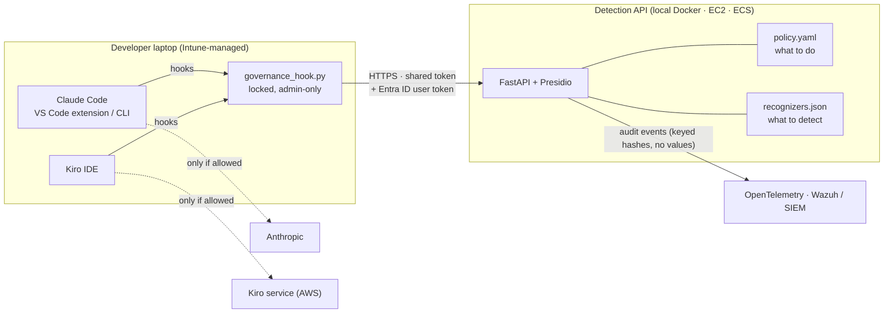

# AI Governance for Coding Assistants

**A data-protection control plane for Claude Code and Kiro IDE, built on Microsoft Presidio.**

AI coding assistants read files, run commands and send all of it to an external model. In a regulated lender, that context can contain Aadhaar and PAN numbers, card and bank details, customer records, credentials and proprietary code. This project puts a policy decision in front of every one of those moments:
- **Every prompt, file read, shell command and MCP call** is checked before it reaches the model.
- **The decision** is allow, mask, pseudonymize, warn-with-justification or block, centrally configured per data class.
- **Every decision is logged** for the SOC, without ever logging the sensitive value itself.

*Version 1.0.0 · MIT License · Python 3.9+ (hooks), 3.10–3.13 (server) · Ubuntu, Windows, macOS*



---

## The governance model

| Control | How it is governed | Where |
| --- | --- | --- |
| **Policy as code**: what happens to each data class | One YAML file, versioned. Per-user exceptions need a reason, an approver and an expiry. Changes apply without restart, and a bad edit never causes an outage or opens the policy | `detection_api/policy.yaml` |
| **Detection as code**: what counts as sensitive | Versioned JSON with its own test samples. Validated (including a speed test against catastrophic regexes) before it goes live. Each version is archived and every change is logged | `detection_api/rules/recognizers.json` · [detection-rules.md](docs/detection-rules.md) |
| **Enforcement points**: the hooks | Claude Code managed settings (users can't disable them); Kiro global hooks re-applied by Intune. Fail closed when the service is down | `clients/` · [ide-hooks.md](docs/ide-hooks.md) |
| **Identity**: who did it | Desktop user by default; in production, the Entra ID access token is verified on every call and compared with the desktop user | [ide-hooks.md, section 5](docs/ide-hooks.md#5-production-verified-user-identity) |
| **Secrets** | No defaults; Docker secrets locally, AWS Secrets Manager with instance or task roles on AWS (no IAM user keys); rotation without lockout | [detection-api.md](docs/detection-api.md) |
| **Audit and response** | One event per decision: user, device, channel, data classes, action, policy and rules versions, matched pattern, and a keyed hash of the value. Justified overrides are logged with their reason; Wazuh rules raise alerts | `siem/wazuh/` · [architecture.md](docs/architecture.md) |
| **Fleet** | One build produces Intune packages for Windows and Ubuntu: version-stamped, self-healing, with the configuration locked | `intune/` · [intune.md](docs/intune.md) |

### Default policy (edit to suit)

| Action | Data classes |
| --- | --- |
| **block** | Card numbers, Aadhaar, IBAN, secrets and API keys, private keys, connection strings with passwords, classification markers ("STRICTLY CONFIDENTIAL") |
| **pseudonymize** (stable token per value) | PAN, voter ID, passport |
| **mask** | Bank account, IFSC, UPI ID, Indian mobile, phone numbers |
| **warn** (allowed with a logged `#justify:` reason) | GSTIN, certificates, e-mail addresses, person names in prompts |
| **path block** (before any scan) | `.env*`, `*.pem`, `*.key`, SSH keys, `customer-data/`, `pii/` |

Hooks can't rewrite a typed prompt in either IDE. For a prompt, mask and pseudonymize therefore mean "blocked, resend the redacted version shown". Files and tool output *are* rewritten in place in Claude Code ([details](docs/ide-hooks.md#what-each-policy-action-means)).

---

## Quick start (local, 10 minutes)

Requires Docker (Engine or Desktop, running) and Python 3.9+.

```bash
git clone https://github.com/<you>/<repo>.git ai-governance && cd ai-governance
python3 scripts/init_secrets.py                   # .env + random secrets in ./secrets
docker compose up -d --build                      # Presidio API + OpenTelemetry collector on 127.0.0.1:8088
python3 tests/test_api.py && python3 tests/test_hooks.py
python3 clients/install_hooks.py --agent both --scope user \
        --api-url http://127.0.0.1:8088 --token-file secrets/gov_api_token --user "$USER"
```

Then fully restart VS Code and Kiro. Try a synthetic sample: `Borrower PAN ABCPE1234F needs re-check` comes back blocked, with the redacted version `<IN_PAN:…>` to resend. `python3 tests/make_samples.py ~/gov-test-repo` creates more samples. Watch the decisions with `tail -f logs/governance-decisions.jsonl`.

On Windows, use `python` and the PowerShell commands in the guides. Low on memory? Set `GOV_NLP_MODEL=en_core_web_sm` in `.env`.

---

## Documentation

| Guide | For | Covers |
| --- | --- | --- |
| [Detection API](docs/detection-api.md) | Platform / DevOps | Install locally, on an AWS test server (EC2, TLS, **Secrets Manager** via instance role) and in production (ECS reference design); testing in each environment; secret rotation |
| [IDE hooks](docs/ide-hooks.md) | Developers, endpoint team | Global hooks for Claude Code (VS Code and CLI) and Kiro, against local, test and production servers; the desktop user; **verified Entra ID identity** for production |
| [Intune rollout](docs/intune.md) | Endpoint / Intune admins | Building and deploying the Windows Win32 app and Ubuntu platform script; verification; rotation; limits |
| [Debugging](docs/debugging.md) | Everyone | Symptoms, causes and fixes, from build failures to TLS, identity and SIEM |
| [Detection rules](docs/detection-rules.md) | Detection owners | Changing patterns without code changes: format, checks, workflow, audit trail |
| [Architecture](docs/architecture.md) | Reviewers, security | How the server works, detection coverage, security design, measured performance |
| [Configuration](docs/configuration.md) | Reference | Every setting, where it is read from, secure storage |
| [Wazuh](siem/wazuh/README-wazuh.md) | SOC | Local Wazuh wiring and alert rules |

---

## Repository layout

```
detection_api/      FastAPI + Presidio server: app/, policy.yaml, rules/recognizers.json, Dockerfile
clients/            governance_hook.py (stdlib only) and install_hooks.py (project, user, managed scopes)
intune/             build_intune_packages.py and Windows/Linux templates
deploy/aws/         EC2 test-server compose + Caddy TLS, least-privilege IAM policy, ECS task template
siem/wazuh/         Wazuh rules for the JSON audit file, setup and end-to-end check
scripts/            init_secrets.py, doctor.py (setup check), validate_rules.py, ci.sh
tests/              API, hooks, rules, policy, identity, AWS secrets; synthetic sample generator
docs/               the guides above
```

## Testing

`bash scripts/ci.sh` runs everything, and GitHub Actions runs the same on every push (`.github/workflows/ci.yml`):

| Suite | Cases |
| --- | --- |
| API (`test_api.py`) | 19 |
| Hooks, both IDE protocols (`test_hooks.py`) | 30 |
| Detection rules incl. live hot reload (`test_rules.py --live`) | 31 |
| Policy reload safety (`test_policy.py`) | 10 |
| Verified identity with a stand-in identity provider (`test_identity.py`) | 21 |
| AWS Secrets Manager and token rotation, simulated AWS (`test_aws_secrets.py`) | 13 |
| Email check without disk cache (`test_offline_suffix.py`) | 2 |

All test data is synthetic: the Aadhaar, PAN, card and account numbers are format-valid fakes, and the keys are documentation examples or dummy strings.

**What is and isn't verified:**
- **Exercised by hand on a local machine:** the local Docker build and the Claude Code VS Code extension. Kiro is covered by the hook-protocol tests.
- **Covered by the automated tests:** everything in the table above.
- **Not yet run:** a real AWS test server, ECS production, a real Entra ID tenant and the Windows Intune scripts. These are provided with their steps, and are marked as such in the guides.

## Status and limits

This is a working reference implementation of a governance design. It is not a certified product or compliance advice. The main limits are documented where they matter:
- **Hooks can't rewrite prompts.**
- **Client-side controls need local admin rights removed.**
- **Kiro hooks live in user profiles**, so Intune re-applies them.
- **Other VS Code assistants**, such as Copilot, aren't covered.

See [intune.md, section 9](docs/intune.md#9-limits) and [SECURITY.md](SECURITY.md).

Built with [Microsoft Presidio](https://microsoft.github.io/presidio/), [spaCy](https://spacy.io/), [FastAPI](https://fastapi.tiangolo.com/) and [OpenTelemetry](https://opentelemetry.io/). Changes per version: [CHANGELOG.md](CHANGELOG.md).
