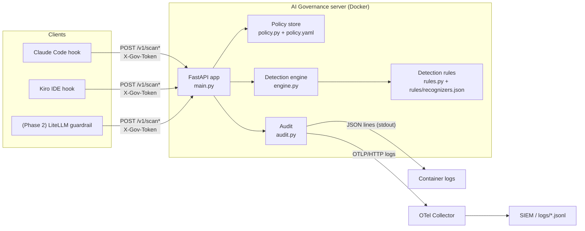
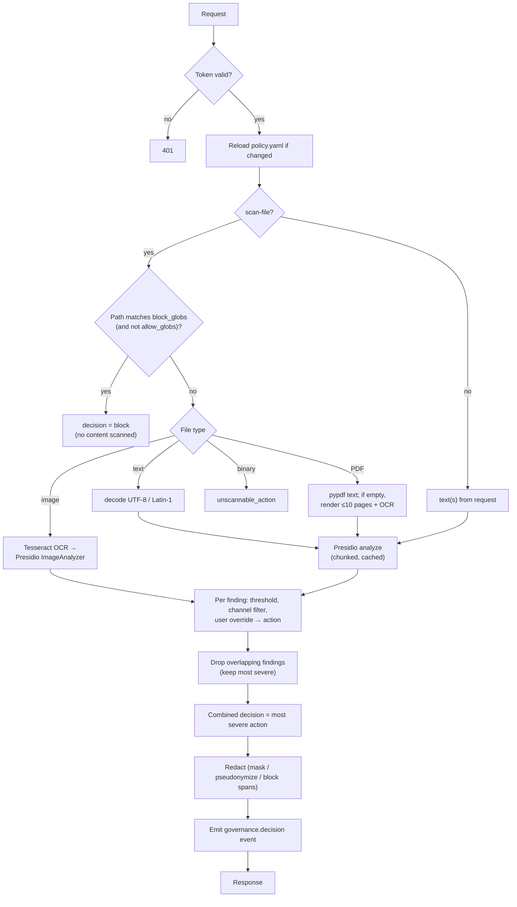

# Architecture: the Presidio-based AI Governance server

*Version 1.0.0, 8 Nov 2026. Describes the code in `detection_api/`. Installing and running it in each environment: `docs/detection-api.md`.*

## 1. Purpose

The AI Governance server is a stateless **FastAPI** service that decides, for any piece of text, file or image an AI coding assistant is about to send or receive, whether it may pass. It answers with **allow**, **mask**, **pseudonymize**, **warn** or **block**. It uses **Microsoft Presidio** for detection, adds India-specific, secrets and classification recognizers, applies an admin-editable policy, and emits an audit event for every decision.

The server never calls an AI model and never forwards traffic. The IDE hook script (`clients/governance_hook.py`, see `docs/ide-hooks.md`) asks it for a decision and enforces the answer inside the IDE.



## 2. Components

| Module | Responsibility |
| --- | --- |
| `app/main.py` | HTTP API, request models, combining findings into one decision, response building |
| `app/identity.py` | Shared-token check (constant time, previous token during rotation) and, with `GOV_AUTH_MODE=token+oidc`, verification of the user's access token (signature via JWKS, issuer, audience, expiry) and the desktop-user comparison |
| `app/engine.py` | Presidio `AnalyzerEngine` setup, text scanning with chunking and caching, redaction, image OCR, PDF and text extraction |
| `app/rules.py` | Loads, validates and hot-reloads `rules/recognizers.json` (custom patterns: Indian financial identifiers, secrets, classification markers), archives each accepted version. See `docs/detection-rules.md` |
| `app/policy.py` | Loads and validates `policy.yaml`, hot-reloads it, path rules, per-user overrides, action severity |
| `app/settings.py` | Configuration from environment, `.env`, secret files or AWS Secrets Manager; refuses unsafe or ambiguous settings |
| `app/audit.py` | `governance.decision` and change events: JSON to stdout, the flat audit file, and OpenTelemetry logs when configured |
| `policy.yaml` | Admin policy: action per data class, thresholds, disabled entities, path rules, overrides |
| `rules/recognizers.json` | Versioned detection rules: regex patterns, scores, context words and test samples per custom recognizer |
| `Dockerfile` | Python 3.12-slim, Tesseract OCR, spaCy model baked in, non-root user, health check |
| `docker-compose.yml` | API plus OpenTelemetry Collector; API bound to `127.0.0.1:8088` |

## 3. API

All `/v1/*` endpoints require the `X-Gov-Token` header when `GOV_API_TOKEN` is set.

| Endpoint | Input | Used for |
| --- | --- | --- |
| `GET /healthz` | — | Liveness, loaded policy and rules versions, NLP model, entity list |
| `GET /v1/rules` | — | Rules version in force, its recognizers, Presidio built-ins, last rejected file, reload history |
| `POST /v1/scan` | `text`, `channel`, context | Prompts, shell commands, tool inputs |
| `POST /v1/scan-batch` | `texts[]`, `channel`, context | Tool output with several string fields. One decision; each string redacted separately, keeping the output's shape |
| `POST /v1/scan-file` | `file_path`, optional `content_b64`, context | Files the agent reads: path rules first, then text, PDF or image scanning |

**Context fields** (all optional, logged for audit): `user`, `host`, `device_id`, `agent` (`claude-code`, `kiro-ide`), `hook_event`, `session_id`, `tool_name`, `cwd`, `justification`.

**Channels:** `prompt`, `attachment`, `file_read`, `tool_input`, `tool_output`, `command`. A policy rule can apply only to some channels. For example, `PERSON` is enforced only on prompts and attachments, because name detection on source code is noisy.

**Response:**

```json
{
  "decision": "pseudonymize",
  "reason": "pseudonymize: IN_PAN x1",
  "findings": [{ "entity": "IN_PAN", "score": 0.85, "action": "pseudonymize",
                 "policy_source": "admin", "value_hash": "1d1b9511…", "start": 4, "end": 14 }],
  "redacted_text": "PAN <IN_PAN:1d1b9511>",
  "event_id": "5ead0eca-…",
  "latency_ms": 8
}
```

`/v1/scan-batch` returns `redacted_texts[]`. `/v1/scan-file` may also return `extraction` (`utf-8`, `pdf-text`, `pdf-ocr`, `ocr`, `binary-unscanned`) and `redacted_image_b64`.

## 4. Request processing



### 4.1 Detection

- **Engine.** Presidio `AnalyzerEngine` with a spaCy NLP engine. The model is `en_core_web_lg` by default, or `en_core_web_sm` for low-memory laptops, set by `GOV_NLP_MODEL`.
- **Recognizers.** Presidio's predefined recognizers, plus the India recognizers registered explicitly, plus the custom ones in section 5, which are built from `rules/recognizers.json`. A new version of that file is validated, built into a complete new analyzer, warmed up and swapped in without a restart; a rejected file leaves the current version in force (`docs/detection-rules.md`).
- **Disabled entities.** Entities listed in `disabled_entities` are never requested from Presidio. This saves time and avoids noise in code; for example, `ORGANIZATION`, `LOCATION`, `DATE_TIME` and `URL` are disabled by default.
- **Chunking.** Text is analysed in 100,000-character chunks (`GOV_CHUNK_CHARS`), and offsets are re-based. Input is capped at 2,000,000 characters (`GOV_MAX_TEXT_CHARS`).
- **Cache.** Results are cached in an LRU keyed by SHA-256 of entity list + text, with 4,096 entries (`GOV_CACHE_SIZE`). Agents re-read the same files and outputs repeatedly, so repeats cost almost nothing. The cache is per worker process and in memory only.

### 4.2 Policy resolution (per finding)

1. Ignore the finding if its score is below the entity's `min_score`, or below the global `score_threshold` (0.5).
2. Ignore it if the entity rule lists `channels` and this channel isn't one of them.
3. Take the entity's `action`, or `default_action` for unlisted entities.
4. If an **unexpired user override** exists for this user and entity, use its action and set `policy_source = user_override`.

**Overlaps.** When two findings cover the same span, the server keeps the most severe action, then the highest score, then the longest match. For example, a Luhn-valid 14-digit bank account number is also a valid card number, so it is treated as `CREDIT_CARD` and blocked. That is the safe side.

### 4.3 Combined decision

Severity order: `allow` < `mask` < `pseudonymize` < `warn` < `block`. The request's decision is the most severe action among its findings.

- **`warn` on a prompt.** The prompt is blocked unless the user adds `#justify: <reason>`; it then becomes `warn_allow`, and the justification is logged.
- **`warn` on other channels** (files, tool output). The content is allowed and logged as `warn_allow`.

### 4.4 Redaction

| Action | Replacement | Property |
| --- | --- | --- |
| `mask` | `<IN_MOBILE>` | Value removed; type kept so the agent can still reason about the data's structure |
| `pseudonymize` | `<IN_PAN:1d1b9511>` | **Stable token**: the same value always gives the same token, so joins and references in code or data still line up |
| `block` | `<CREDIT_CARD>` in the redacted copy | The decision is still **block**; the redacted text is offered only so the user can resend |

Pseudonym tokens are the first 8 hex characters of an HMAC-SHA256 of the value, keyed with `GOV_HASH_KEY`. Without the key, a token can't be reversed or brute-forced against a list of known PANs. There is **no reverse mapping store**: restoring original values in responses is not implemented, which keeps the server stateless and PII-free.

### 4.5 Files, PDFs and images

| Input | Handling |
| --- | --- |
| Path rules | `block_globs` (e.g. `**/.env`, `**/*.pem`, `**/customer-data/**`) block before any content is read; `allow_globs` (e.g. `**/.env.example`) take precedence |
| Text and code | Decoded as UTF-8, falling back to Latin-1, then scanned |
| PDF | `pypdf` text extraction. If there's no text layer, up to 10 pages (`GOV_MAX_PDF_OCR_PAGES`) are rendered with `pypdfium2` and OCR'd with Tesseract. Scanned on the `attachment` channel |
| Images (`.png`, `.jpg`, …) | Presidio `ImageAnalyzerEngine` (Tesseract OCR + the same analyzer). `ImageRedactorEngine` returns a PNG with detected values blacked out |
| Unknown binary | `unscannable_action` from policy (default `warn`, which allows and logs for files) |
| Files over 10 MB | Blocked by the hook client before upload (`GOV_MAX_FILE_MB`) |

## 5. Detection coverage

| Data class | Entity | Source | Default action |
| --- | --- | --- | --- |
| Aadhaar | `IN_AADHAAR` | Presidio built-in (checksum-validated) | block |
| PAN | `IN_PAN` | Presidio built-in | pseudonymize |
| Voter ID, passport | `IN_VOTER`, `IN_PASSPORT` | Presidio built-in | pseudonymize |
| GSTIN | `IN_GSTIN` | Presidio built-in | warn |
| Card numbers | `CREDIT_CARD` | Presidio built-in (Luhn) | block |
| IBAN | `IBAN_CODE` | Presidio built-in | block |
| Bank account number | `IN_BANK_ACCOUNT` | Custom (all "Custom" rows come from `rules/recognizers.json`): 9–18 digits, low base score, raised by context words (*account*, *a/c*, *NEFT*…) | mask |
| IFSC | `IN_IFSC` | Custom: `AAAA0XXXXXX` | mask |
| UPI ID | `IN_UPI_ID` | Custom: `handle@psp` (dot-less PSP, which separates it from email) | mask |
| Indian mobile | `IN_MOBILE` | Custom: `+91`/`0091` prefixed (high score) or bare 10-digit `6–9…` (low score, context-boosted) | mask |
| Phone, email, person | `PHONE_NUMBER`, `EMAIL_ADDRESS`, `PERSON` | Presidio built-in (NER for `PERSON`) | mask / warn / warn (prompts and attachments only, score ≥ 0.85) |
| API keys and tokens | `SECRET` | Custom: AWS, GitHub, Anthropic, OpenAI, Slack, Google, Stripe, Azure storage, JWT, `password=`/`api_key=` assignments | block |
| Private keys | `PRIVATE_KEY` | Custom: PEM `BEGIN … PRIVATE KEY` headers | block |
| Certificates | `CERTIFICATE` | Custom | warn |
| Connection strings | `CONNECTION_STRING` | Custom: URIs with embedded passwords (Postgres, MySQL, Mongo, Redis, AMQP, JDBC…) and ADO.NET `Password=` | block |
| Confidential documents | `CLASSIFICATION_MARKER` | Custom: *Strictly confidential*, *Internal use only*, … | block |

**Not detected by content:** proprietary source code that carries no marker. That is controlled by path rules, the IDE deny rules and `kiroignore` (see `docs/ide-hooks.md` and `docs/intune.md`).

## 6. Policy (`policy.yaml`)

```yaml
version: 1
score_threshold: 0.5
default_action: allow
unscannable_action: warn
entities:
  IN_AADHAAR:   { action: block }
  IN_PAN:       { action: pseudonymize }
  IN_MOBILE:    { action: mask }
  PERSON:       { action: warn, min_score: 0.85, channels: [prompt, attachment] }
disabled_entities: [DATE_TIME, NRP, LOCATION, ORGANIZATION, URL, ...]
path_rules:
  block_globs: ["**/.env", "**/*.pem", "**/customer-data/**", ...]
  allow_globs: ["**/.env.example"]
user_overrides:
  - { user: a@x.com, entity: PERSON, action: allow, reason: "...", approved_by: "...", expires: "2026-12-31" }
```

- **Hot reload.** The file's timestamp is checked on every request. A changed file is re-parsed and **validated before it replaces** the active policy. A bad edit (YAML error, unknown action, missing override field, deleted file) is rejected: the previous policy stays in force, requests keep working, `/healthz` shows `policy_last_error`, and a `governance.policy_rejected` event is logged once. At start-up a bad policy stops the server. No restart is needed for a good edit.
- **Overrides.** Every override must carry `reason`, `approved_by` and `expires`. Expired overrides are ignored automatically, and every use is logged with `policy_source = user_override` for SIEM alerting.
- **Deployment.** In Docker the file is mounted read-only from the host (`./detection_api/policy.yaml:/app/policy.yaml:ro`).

## 7. Audit and observability

Every request emits one `governance.decision` event. A changed rules file emits `governance.rules_loaded` or `governance.rules_rejected` (`docs/detection-rules.md`, section 5).

```json
{
  "event.name": "governance.decision", "event.id": "…", "timestamp": "2026-10-27T18:07:06Z",
  "user.id": "deepak@…", "host.name": "…", "device.id": "…", "agent": "kiro-ide",
  "hook.event": "prompt", "session.id": "…", "tool.name": "", "channel": "prompt",
  "decision": "pseudonymize", "reason": "pseudonymize: IN_PAN x1", "justification": null,
  "data_classes": ["IN_PAN"], "policy_sources": ["admin"],
  "findings": [{ "entity": "IN_PAN", "score": 0.85, "action": "pseudonymize",
                 "policy_source": "admin", "value_hash": "1d1b9511…",
                 "recognizer": "InPanRecognizer", "pattern": "PAN (High)" }],
  "rules.version": "2026.11.08.1", "policy.version": 1,
  "latency_ms": 8, "text.length": 14
}
```

- **Audit file for Wazuh.** When `GOV_AUDIT_FILE` is set, each event is also appended to that file as one *flat* JSON object, with all fields under `governance`, lists as comma-separated strings and no dotted keys. That shape suits Wazuh's JSON decoder; the rules are in `siem/wazuh/`. User justifications are scanned and masked before any sink sees them.
- **Sinks.** Each event goes to stdout as one JSON line. When `OTEL_EXPORTER_OTLP_ENDPOINT` is set, it is also sent as an **OpenTelemetry log record** over OTLP/HTTP (`/v1/logs`). The bundled Collector writes these to `logs/governance-events.jsonl`; add a SIEM exporter in `otel-collector.yaml`.
- **No raw values.** Matched values are never logged. Each finding carries a keyed hash, which lets the SIEM correlate repeated leaks of the same value without storing it. This was verified: a test PAN appeared in neither the OTLP export nor stdout.
- **Suggested alerts:**
  - Any `block` on `IN_AADHAAR` or `CREDIT_CARD`.
  - More than five blocks per user per hour.
  - Any `policy_source = user_override`.
  - IDE activity with no matching governance events (bypass).

## 8. Security design

| Concern | Control |
| --- | --- |
| Unauthorised callers | Shared `X-Gov-Token` (constant-time check; previous token accepted during rotation); API bound to `127.0.0.1` locally, TLS and network restriction elsewhere |
| Who is the user? | `GOV_AUTH_MODE=token+oidc`: Entra ID access token verified per request (RS256 via the tenant's JWKS, exact issuer, audience, expiry; `HS*`/`none` refused). The verified account drives per-user overrides and the audit `user_id`; the desktop name is kept as `user_claimed`, and mismatches are logged or refused |
| PII at rest | None stored: no database, no reverse map; cache is in-memory, per process |
| PII in logs | Keyed hashes only; prompt text never logged |
| Container | Non-root user (UID 10001), read-only policy mount, health check, no egress needed at runtime (spaCy model baked in at build; public-suffix list bundled with tldextract, no disk cache) |
| Fail-safe | Hooks **fail closed** when the server is unreachable or times out (3 s default) |
| Policy and rules integrity | Validation before activation; a bad edit leaves the previous version in force (never fail open, never an outage) and is logged for the SOC |
| Secrets in config | No defaults: the server refuses to start without `GOV_API_TOKEN` and `GOV_HASH_KEY`. Docker secrets locally (`GOV_*_FILE`), Secrets Manager on AWS; constant-time token check. See `docs/configuration.md` |

## 9. Performance (measured in the build environment)

| Operation | Observed |
| --- | --- |
| Text scan (prompt or small file), warm | 6–15 ms |
| One-off slow request seen outside Docker (0.71 s) | The email/URL recognizers tried to download the public-suffix list; since 0.6.1 the server uses the bundled list with the disk cache off |
| Repeat of identical content | under 1 ms (cache) |
| Image OCR (one screenshot) | 2.7 s, the only path over the 1-second budget |

The container runs **2 uvicorn workers** (each loads its own spaCy model and cache). Scale horizontally for more throughput; the service is stateless.

**Test suites** (all run by `scripts/ci.sh` and GitHub Actions):

| Suite | Cases | Covers |
| --- | --- | --- |
| `tests/test_api.py` | 19 | Every data class and action through the API |
| `tests/test_hooks.py` | 30 | Both IDE protocols, fail-closed, configuration, older Kiro payloads |
| `tests/test_rules.py` | 26 (31 with `--live`) | Rules file validation, version discipline, hot reload |
| `tests/test_policy.py` | 10 | Bad policy edits never cause an outage or open the policy |
| `tests/test_identity.py` | 21 | Verified identity end to end with a stand-in identity provider |
| `tests/test_aws_secrets.py` | 13 | Secrets Manager loading and token rotation (simulated AWS) |
| `tests/test_offline_suffix.py` | 2 | Email check never touches a disk cache |

## 10. Configuration reference

Every setting, its default and where it is read from: `docs/configuration.md`.

## 11. Environments

| Local | Test server (built: `deploy/aws/`) | Production (reference design) |
| --- | --- | --- |
| Docker Compose on a laptop | EC2 + Docker Compose + Caddy TLS | ECS Fargate behind an **internal** ALB with an ACM certificate |
| `./secrets/` files | Secrets Manager, instance role | Secrets Manager, task role |
| Shared token | Shared token, optionally + Entra ID | Shared token + Entra ID (`token+oidc`) |
| Collector to file | Collector to file / SIEM | Collector or ADOT to the SIEM; CloudWatch Logs |
| Mounted `policy.yaml`, `rules/` | Mounted from the checkout | Baked per release or EFS; AWS AppConfig for staged rule rollouts |
| Hooks to `127.0.0.1:8088` | Hooks to `https://<test host>` (`GOV_CA_BUNDLE` for a private CA) | Hooks to the internal ALB over VPN or ZTNA; Intune packages rebuilt with the new `--api-url` |

Later phase: an LLM gateway (for example LiteLLM) for Claude Code calling `/v1/scan` as a pre-call guardrail, which would allow in-flight prompt and image redaction.

Hosting in an Indian region keeps the only component that sees raw sensitive values in India. That matters for RBI payment-data localisation and DPDP.

## Sources

- [Microsoft Presidio image redactor](https://microsoft.github.io/presidio/image-redactor/)
- [Presidio entity catalog (India entities)](https://tessl.io/registry/testland/presidio-pii-detection/files/references/entity-catalog.md)
- [LiteLLM Presidio guardrail](https://docs.litellm.ai/docs/proxy/guardrails/pii_masking_v2)
- [RBI FAQ: Storage of Payment System Data](https://rbi.org.in/scripts/FS_FAQs.aspx?Id=130)
