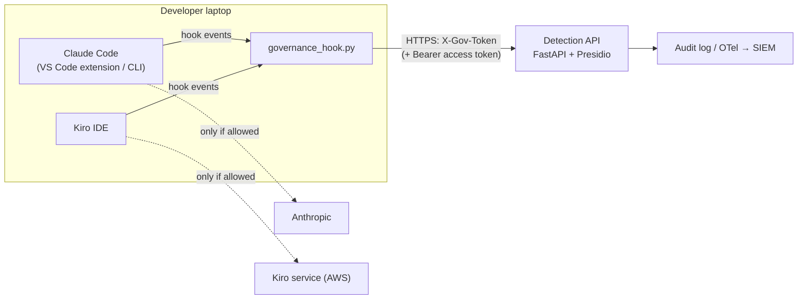

# IDE hooks: Claude Code (VS Code and CLI) and Kiro, globally

*Version 1.0.0, 8 Nov 2026.*

This guide connects the IDEs to the Detection API for **every project** on a machine:
- **Sections 3–4:** against a local Docker server, then a test or production server.
- **Section 5:** the production identity check, which ties every decision to the signed-in Entra ID account and compares it with the desktop user.
- **[intune.md](intune.md):** enforcing all of this on the fleet.

## 1. How it works



The IDEs run a small hook script at fixed points in the agent loop. The script sends the content to the Detection API and turns the decision into the IDE's own "allow", "block" or "rewrite" answer. Model traffic doesn't pass through the API.

**"VS Code" here means the Claude Code extension.** VS Code itself has no AI hook system. The extension and the Claude Code CLI read the same settings files (`~/.claude/settings.json`), so one install covers both. Other assistants in VS Code, such as GitHub Copilot, are **not** covered.

### What each event does

| Event | Claude Code | Kiro IDE |
| --- | --- | --- |
| Prompt submitted | Block or allow | Block or allow |
| Agent reads a file | Deny, allow, or **serve a redacted copy** in place | Block, or block and point the agent to a redacted copy |
| Shell command, MCP call | Deny if it contains restricted data | Block |
| Tool output (shell, grep, web, MCP) | **Redacted in place** before the model sees it | Logged; Kiro can't rewrite output |
| Detection API unreachable or erroring | Blocked (fail closed) | Blocked (fail closed) |

### What each policy action means

| Action in `policy.yaml` | Typed prompt | Files, command output, MCP results |
| --- | --- | --- |
| `pseudonymize` | Blocked, with the redacted version to resend: `<IN_PAN:7067b737>` | Replaced in place with the stable token |
| `mask` | Same, with `<IN_PAN>` | Replaced in place with `<IN_PAN>` |
| `warn` | Blocked until resent with `#justify: <reason>`; then sent as typed, and the reason is logged | Allowed and logged (`warn_allow`), no reason asked |
| `block` | Blocked | Read or command refused |

Prompts are blocked rather than rewritten because Claude Code's `UserPromptSubmit` hook "can't replace the prompt; it only injects `additionalContext` alongside it", whereas `PreToolUse` and `PostToolUse` hooks can replace tool input and output [1]. Kiro hooks can only allow or block.

---

## 2. Install scopes

| Scope | Command | Covers | Admin rights | Can the user remove it? |
| --- | --- | --- | --- | --- |
| `--scope project --project <repo>` | Per repo | One repository | No | Yes |
| **`--scope user`** | Per user | **Every project** for the signed-in user | No | Yes |
| `--scope managed` | Machine-wide | Every user and project | Yes (sudo / elevated) | **No**: managed settings, admin-only folder ([intune.md](intune.md)) |

Use one scope per machine. Combining them makes every check run twice. `--uninstall` with the same scope removes what that scope added.

---

## 3. Global install against the local Docker API

Start the server first ([detection-api.md, section 2](detection-api.md#2-local)). Then, from the project folder:

```bash
# Ubuntu / macOS
python3 clients/install_hooks.py --agent both --scope user \
        --api-url http://127.0.0.1:8088 --token-file secrets/gov_api_token --user "$USER"
```
```powershell
# Windows (PowerShell)
python clients\install_hooks.py --agent both --scope user `
       --api-url http://127.0.0.1:8088 --token-file secrets\gov_api_token --user "$env:USERNAME"
```

`--agent claude` or `--agent kiro` installs for one IDE only. What it writes (`~` is `/home/<you>` or `C:\Users\<you>`):

| File | What | Applies to |
| --- | --- | --- |
| `~/.claude/settings.json` | Three hooks, plus `Read` deny rules for secrets files (merged into your existing settings) | Claude Code CLI and the VS Code extension |
| `~/.kiro/hooks/ai-governance.json` | Six global hooks | Every Kiro workspace (Kiro IDE 1.0.182+, 1.2+ recommended) |
| `~/.kiro/settings/kiroignore` | Global ignore list | Every Kiro workspace |
| `~/.ai-governance/governance_hook.py`, `governance.env` | Hook script and its config (owner-only) | Both |
| `~/.ai-governance/api_token` | The token, owner-only; only without the optional `keyring` package, which stores it in the OS credential store instead | Both |
| `~/.ai-governance/kiro-hook.cmd` | Windows only: launcher the Kiro hooks call | Kiro |

**The identity in the audit log (`--user`).** The commands take your desktop sign-in name, so nothing is typed by hand:

| You want the audit log to show | Use |
| --- | --- |
| Desktop user name, e.g. `deepak` | `--user "$USER"` / `--user "$env:USERNAME"` |
| Domain and user, e.g. `CORP\deepak` | Windows: `--user "$env:USERDOMAIN\$env:USERNAME"` |
| Work e-mail (UPN), Entra ID or domain-joined Windows | `--user "$(whoami /upn)"` |
| Whoever is signed in at each call (shared machines) | Leave `--user` out: the hook asks the OS on every call |

This name is **self-reported**. Section 5 replaces it with a verified one in production.

**Verify:**
1. **Check the files were written:** `python3 -m json.tool ~/.claude/settings.json | grep -n "UserPromptSubmit\|governance_hook"`, then `ls -la ~/.ai-governance ~/.kiro/hooks`.
2. **Fully quit and reopen** VS Code and Kiro, then open any folder.
3. **Claude Code:** start a **new** session and type `/hooks`. You should see `UserPromptSubmit`, `PreToolUse` and `PostToolUse`.
4. **Kiro:** in the Kiro panel, open **Agent Hooks**. Six `ai-governance:` hooks should be listed and enabled.
5. **Try the samples:** `python3 tests/make_samples.py ~/gov-test-repo` writes synthetic files and prints prompts with the expected result of each. For example, `Borrower PAN ABCPE1234F needs re-check` comes back blocked with the redacted version.

---

## 4. Global install against a test or production server

The same command, with an `https://` address. The hook refuses `http://` to anything but loopback.

```bash
python3 clients/install_hooks.py --agent both --scope user \
        --api-url https://governance-test.corp.internal --token-file ~/gov_api_token --user "$USER" \
        --set GOV_CA_BUNDLE="$HOME/governance-test-ca.pem"
```

- **Token:** get it from the server owner, or from Secrets Manager if you have access ([detection-api.md, 4.6](detection-api.md#46-test-the-test-server)). Write it to a file only you can read (`chmod 600`), then delete the file after installing. The installer moves the token into the OS credential store, or an owner-only file.
- **`GOV_CA_BUNDLE`:** only if the server's certificate comes from a private CA, such as Caddy's local CA on the test server.
- **Timeouts:** the IDE waits up to 10 s per prompt and 15 s per tool hook (`--prompt-timeout`, `--tool-timeout`), and the hook allows the API 3 s per call (`--set GOV_TIMEOUT=5` to raise it). Remote servers add network latency, so check `latency_ms` in the audit log.
- **Switching servers:** run the command again with the new address. It replaces the hook config.

For the fleet, don't install per user: the Intune packages install the same hooks machine-wide, with the token, CA bundle and identity settings built in ([intune.md](intune.md)).

---

## 5. Production: verified user identity

### 5.1 Why

With the shared token alone (`GOV_AUTH_MODE=token`), the API knows the request came from an installed hook. The user name comes from the laptop and could be anything. That has two effects:
- the audit log records it as `user_claimed`, with `user_verified: false`;
- per-user overrides in `policy.yaml` can't be trusted.

In production, set `GOV_AUTH_MODE=token+oidc`. Each request then carries:
- **the shared token**, proving it comes from a managed install;
- **the user's access token from Microsoft Entra ID**, proving who is signed in.

### 5.2 What happens on each call

```mermaid
sequenceDiagram
  participant IDE as Claude Code / Kiro
  participant H as governance_hook.py
  participant AZ as Azure CLI (az)
  participant API as Detection API
  participant IDP as Entra ID keys (JWKS)
  IDE->>H: hook event (prompt, file read, tool call)
  H->>H: cached access token still valid (> 2 min)?
  alt no
    H->>AZ: GOV_ID_TOKEN_COMMAND
    AZ-->>H: access token for the governance API
  end
  H->>API: X-Gov-Token + Authorization: Bearer <token> + desktop user
  API->>IDP: signing keys (cached; refetched on an unknown key)
  API->>API: verify signature (kid), iss, aud, exp
  API->>API: compare desktop user with signed-in account
  API-->>H: decision (or 401 / 403)
  H-->>IDE: allow / block / rewrite
```

The API checks what Microsoft's documentation requires of a web API:
- **Audience:** it accepts only tokens with its own ID in `aud`.
- **Issuer:** `iss` must match the configured issuer exactly.
- **Signature:** verified with the public key that the token's `kid` selects from the tenant's `jwks_uri` [2][3].

Asymmetric algorithms only: `HS*` and `none` are refused at start-up.

### 5.3 Register the API in Microsoft Entra ID (once)

1. **Register an app** in the Entra admin center: App registrations → New registration, name `AI Governance API`, single tenant.
2. **Expose an API:** set the Application ID URI (e.g. `api://<application-client-id>`) and add a scope, e.g. `Governance.Scan`, with admin consent.
3. **Pre-authorize the Azure CLI**, so developers aren't asked for consent: under *Authorized client applications*, add the Azure CLI's client ID for that scope. Microsoft lists the Azure CLI's application ID as `04b07795-8ddb-461a-bbee-02f9e1bf7b46` [5].
4. **Request v2.0 access tokens:** in the app manifest set `requestedAccessTokenVersion` to `2`. The values `null` and `1` give v1.0 tokens [3]. With v2.0 tokens, `aud` is the API's client ID and `iss` ends in `/v2.0` [2].
5. **Optional:** under *Enterprise applications → Properties*, set *Assignment required* and assign the developer group. Then only those users can get a token.

### 5.4 Configure the server

```bash
GOV_AUTH_MODE=token+oidc
GOV_OIDC_ISSUER=https://login.microsoftonline.com/<tenant-id>/v2.0
GOV_OIDC_AUDIENCE=<application-client-id>
GOV_OIDC_JWKS_URL=https://login.microsoftonline.com/<tenant-id>/discovery/v2.0/keys
GOV_IDENTITY_MISMATCH=log           # start with log; switch to block after reviewing
```

| Setting | Default | Notes |
| --- | --- | --- |
| `GOV_OIDC_AUDIENCE` | — | Comma-separated; add the `api://…` URI too if some clients request v1.0 tokens |
| `GOV_OIDC_USER_CLAIMS` | `preferred_username,upn,unique_name,email` | First present claim becomes `user_id`. Microsoft marks these as display values, not for authorization [2], so the immutable ID is logged too |
| `GOV_OIDC_ID_CLAIMS` | `oid,sub` | Logged as `user_subject_id`: stable even if the user is renamed |
| `GOV_OIDC_ALGORITHMS` | `RS256` | |
| `GOV_IDENTITY_MISMATCH` | `log` | `block` answers 403 when the desktop user isn't the signed-in account |

`/healthz` then reports `"auth": "token+oidc"`. The signing keys are fetched over HTTPS and cached for an hour, and a token with an unknown key ID triggers a refetch (key rotation). If the keys can't be fetched, requests fail closed with HTTP 503.

### 5.5 Configure the hooks

The hook gets the user's access token by running a command, cached per user in `~/.ai-governance/id_token.cache` (owner-only) until 2 minutes before it expires. The Azure CLI command:

```bash
az account get-access-token --scope api://<application-client-id>/.default --query accessToken -o tsv
```

`--scope` takes Microsoft Entra v2.0 scopes, and tokens are valid for 5 to 60 minutes [4]. Each developer signs in once with `az login`. On Intune-managed, Entra-joined devices, single sign-on usually makes that a one-click step.

- **Per user (pilot):** add `--set "GOV_ID_TOKEN_COMMAND=az account get-access-token --scope api://<id>/.default --query accessToken -o tsv"` to the section 4 command.
- **Fleet:** pass the same `--set` to `intune/build_intune_packages.py` ([intune.md](intune.md#2-build-the-packages)). It lands in the locked, admin-only config, and users can't change it.

If the command fails (not signed in, `az` missing, over 8 s), the hook blocks with "could not get your sign-in token (sign in again, e.g. 'az login')". If the server rejects an expired or revoked token, the hook fetches a fresh one once and retries.

### 5.6 Desktop user vs signed-in account

The API compares the desktop name the hook sends (`--user` or the OS user) with the verified account:

| Desktop user | Signed-in account | Result |
| --- | --- | --- |
| `deepak`, `CORP\deepak`, `deepak@corp.example` | `deepak@corp.example` | Match |
| `someone.else` | `deepak@corp.example` | **Mismatch**: logged (rule 100160) or refused with 403 (`block`, rule 100161) |

Every decision then records:
- `user_id`: the verified account. Policy overrides use this one.
- `user_claimed`: the desktop name.
- `user_subject_id`: the immutable `oid`.
- `user_verified: true`.
- `identity_mismatch`.

A mismatch usually means a shared login, a copied hook config, or an `az` session signed in to the wrong account. Each is worth a look for the SOC.

### 5.7 Rollout order

1. **Server in `token+oidc` with `GOV_IDENTITY_MISMATCH=log`** on the test server, with a few pilot users who have `GOV_ID_TOKEN_COMMAND`.
2. **Check the audit log:** `user_verified: true` on every event, and no unexplained `identity_mismatch`.
3. **Fleet:** rebuild the Intune packages with `--set GOV_ID_TOKEN_COMMAND=…` and roll out.
4. **Switch to `GOV_IDENTITY_MISMATCH=block`** once mismatches are understood.

The whole flow is covered by `tests/test_identity.py`, which plays the identity provider with its own signing key:
- **Refused:** forged, expired, unsigned, wrong-audience and wrong-issuer tokens.
- **Accepted:** a valid token, with the verified identity in the audit log.
- **Mismatches:** logged or blocked, depending on `GOV_IDENTITY_MISMATCH`.
- **Hook token cache:** the token command ran once for two prompts.

I haven't tested against a real Entra tenant.

---

## 6. Remove

```bash
python3 clients/install_hooks.py --agent both --scope user --uninstall
```

This removes the hooks from `~/.claude/settings.json` (your other settings stay), the Kiro hook file and the governance block in `~/.kiro/settings/kiroignore`. The hook script and its config stay in `~/.ai-governance/`. Delete that folder by hand if you're done with it.

---

## Sources

1. [Hooks reference — Claude Code docs](https://code.claude.com/docs/en/hooks)
2. [Access token claims reference — Microsoft identity platform](https://learn.microsoft.com/en-us/entra/identity-platform/access-token-claims-reference)
3. [Access tokens in the Microsoft identity platform](https://learn.microsoft.com/en-us/entra/identity-platform/access-tokens)
4. [az account get-access-token — Azure CLI reference](https://learn.microsoft.com/en-us/cli/azure/account?view=azure-cli-latest)
5. [Plan for mandatory Microsoft Entra MFA — application IDs table](https://learn.microsoft.com/en-us/entra/identity/authentication/concept-mandatory-multifactor-authentication)
6. [Kiro hooks](https://kiro.dev/docs/hooks/) and [Kiro IDE global hooks, v1.0.182 (Classmethod)](https://dev.classmethod.jp/articles/kiro-ide-10182-global-hooks/)
